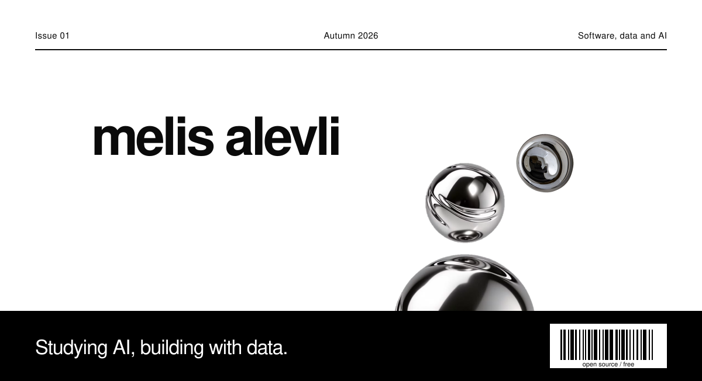

  <picture>
    <source media="(prefers-color-scheme: dark)" srcset="assets/cover-dark.svg">
    
  </picture>

 

 
I like the work where data, AI and product thinking meet. 
📍MS in Computer Science (AI), United States
 
 

  

 

<h2 align="center">Projects</h2>

####   [**Feasto**](https://feasto.pages.dev)
> A recipe-planning web app that organizes recipes by ingredient availability, recommends ingredient substitutions, generates shopping lists, and helps users discover new recipes to simplify everyday meal planning.

####   [**Sounre**](https://sounre.onrender.com)
> A music discovery web app that analyzes a song's genre composition and recommends similar songs based on genre similarity. It allows users to listen to previews, and access streaming platforms, helping users find songs that match their musical taste.
 
####   [**Bunny Dive**](https://bunnydive.pages.dev)
> A web app that lets you explore Wikipedia through a branching trail of related topics, following a path of 14 topics before showing you the complete journey.

#### [**Telecom Churn Prediction**](https://github.com/melisalevli/capstone_churn)
> Developed a scalable predictive model for customer churn, resolving class imbalance using **SMOTE, ADASYN, ROS, RUS,** and **SMOTE-ENN**.
> Tuned **XGBoost, Random Forest, SVM,** and **ANN** models via Optuna and cross-validation, translating feature importance into actionable business strategies.

#### [**Talk 2-2**](https://github.com/melisalevli/talk2-2)
> Web application that analyzes speech patterns using AI to deliver personalized communication feedback.
 

---

[LinkedIn](https://www.linkedin.com/in/melis-alevli) · [Email](mailto:melisalevli2@gmail.com)
